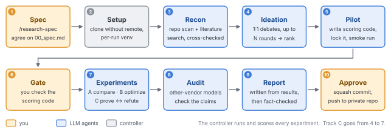

# AI-autoresearch

[한국어](#한국어) | [English](#english)

---

## 한국어

### 무엇인가

자율 연구 도구입니다. 연구 질문 하나를 주면 여러 언어 모델(Claude, Gemini 계열 `agy`, Codex)이 선행연구 조사, 아이디어 토론, 파일럿, 본 실험이나 증명, 교차 감사, 보고서 작성까지 차례로 해 나갑니다. 트랙 A·C의 선행연구는 세 벤더가 따로 조사한 뒤 합치고, 인용한 논문이 실제로 있는지 직접 조회합니다. 아이디어 토론에서는 제안하는 모델과 비평하는 모델이 1:1로 여러 회차 주고받습니다. 사람은 처음에 명세를 정하고, 중간의 몇 군데 관문에서 확인만 합니다. 설계 전체는 [docs/design_ko.md](docs/design_ko.md)에 있습니다.

연구 목적에 따라 세 갈래(트랙)로 나뉘고, 한 번 실행할 때 트랙 하나를 고릅니다.
- 트랙 A: 새 양자 모델이나 방법이 실제로 쓸모 있는지 기준선과 비교해 확인합니다.
- 트랙 B: 코드, 시뮬레이터, 알고리즘을 정확도를 지키면서 더 빠르게 만듭니다.
- 트랙 C: 새 정리를 증명하고, 다른 모델이 그 증명을 반박하며 수치로 반례를 찾습니다.

### 어떻게 돌아가나



원칙은 다섯 가지입니다.
- 원본 저장소의 브랜치는 건드리지 않습니다. 실행마다 클론을 만들고 그 안에서만 작업합니다. 원본에는 마지막에 사람이 승인할 때 새 브랜치 하나만 생깁니다.
- 모든 권한을 주는 단계는 코드를 고치는 단계뿐입니다. 조사, 비평, 감사처럼 코드를 고치지 않는 단계는 읽기 전용으로 부르고, 그 출력은 제어기가 파일로 저장합니다.
- 실험 실행과 채점은 에이전트가 아니라 제어기가 합니다. 채점 파일은 잠그고 SHA-256 해시로 바뀌었는지 매번 확인합니다. 채점 정답은 클론 밖(`hidden/`)에 두고 채점할 때만 경로를 넘깁니다.
- 한 번 재고 끝내지 않습니다. 트랙 A는 시드를 바꿔 여러 번 돌려 평균과 표준오차를, 트랙 B는 수정 전과 수정 후를 번갈아 여러 번 재 중앙값을 비교합니다. 결론 수치는 본 실험이 끝난 뒤 한 번 더 잰 값입니다. 트랙 A는 본 실험 동안 채점하지 않은 최종 시험 세트로, 트랙 B는 원래 코드와 최종 코드를 직접 번갈아 재서 냅니다.
- 글을 쓰는 모델과 반박·감사하는 모델은 다른 회사 모델로 둡니다. 명세에 한 회사 모델만 있으면(그 회사만 구독한 경우) 같은 회사의 다른 모델로 대신하고, 그 사실을 완료 알림에 적습니다.

### 파일은 어디에 있나

세 곳으로 나뉩니다.

**1. 모든 프로젝트가 같이 쓰는 것 (이 레포)**

```
~/autoresearch/                 이 레포를 여기에 클론
├── run_research.py             제어기. 단계를 돌리고, 실험을 실행·채점하고, 관문에서 기다림
├── llm_router.py               세 CLI 호출, 안전 수칙 주입, 호출 상한·대체·승격
├── notify.py                   Slack 알림 (선택)
├── providers.yaml              벤더를 "어떻게" 부르는지: 모델 ID, CLI 플래그, 승격 순서, 대체 모델
├── prompts/                    단계별 지침
├── templates/00_spec_template.md   명세 틀 (기본 모델 배정과 호출 상한 포함)
├── commands/research-spec.md   Phase 0 명령 → ~/.claude/commands/ 에 심볼릭 링크
└── docs/design_ko.md           설계 문서
```

**2. 프로젝트마다 다른 것 (각 프로젝트 저장소 안)**

```
<프로젝트>/
├── .autoresearch/defaults.yaml     (선택) 이 프로젝트에서 늘 같은 값: env, 설치 명령, 자주 쓰는 모델 배정
├── .autoresearch/runs/<run_id>/    실행 폴더의 00_spec.md, providers.yaml을 가리키는 링크 (git에서 제외)
└── research_runs/<run_id>/         push를 승인하면 브랜치 autoresearch/<run_id>로 들어오는 결과
```

**3. 실행마다 생기는 것 (프로젝트 밖)**

```
~/autoresearch_runs/<프로젝트>/<run_id>/
├── 00_spec.md        이번 실행의 명세. "무엇을 얼마나" 부를지 전부 여기에
├── providers.yaml    전역 providers.yaml의 사본. 이 실행은 이 사본을 쓴다
├── state.json        진행 상태. 끊겨도 --resume으로 이어감
├── llm_logs/         모델에 보낸 프롬프트와 출력 전체
├── venv/             실행 전용 venv (기준 env의 패키지를 그대로 보고 새 설치만 여기에)
├── hidden/           채점 정답 (에이전트 작업 공간 밖)
└── repo/             원본 클론 (원격 없음)
    └── research_runs/<run_id>/   산출물: 조사, 아이디어, 채점 코드, 실험 기록, 감사, 보고서
```

실행 폴더를 프로젝트 밖에 두는 이유는 두 가지입니다. 모든 권한을 받은 에이전트가 클론 바깥에서 git 명령을 치면 원본 저장소가 잡히고, 검색 도구와 IDE가 클론 사본까지 훑습니다.

### 설정은 겹치지 않게

| 파일 | 담는 것 | 언제 읽나 |
|---|---|---|
| `providers.yaml` | 벤더를 어떻게 부르는지 | 실행 때 |
| `00_spec.md`의 yaml 블록 | 무엇을 얼마나 부를지 전부 (단계별 모델 배정 `stages`, 호출 상한 `budget.run_limits`) | 실행 때. 적힌 값 그대로 |
| `<프로젝트>/.autoresearch/defaults.yaml` | 프로젝트 기본값 | `/research-spec`이 명세를 채울 때만 |

defaults.yaml이 없으면 같은 프로젝트의 직전 명세를, 그것도 없으면 템플릿 값을 씁니다.

### 설치

1. `claude`, `agy`, `codex` CLI를 설치하고 로그인합니다. `tmux`, `git`도 필요합니다.
2. 이 레포를 `~/autoresearch`에 클론합니다. 명령 파일과 문서는 이 경로를 전제로 쓰여 있습니다.
   ```bash
   git clone https://github.com/Shawn-Hyunwoo/AI-autoresearch.git ~/autoresearch
   ```
3. Phase 0 명령을 연결합니다.
   ```bash
   mkdir -p ~/.claude/commands
   ln -s ~/autoresearch/commands/research-spec.md ~/.claude/commands/research-spec.md
   ```
4. 제어기를 돌릴 python에 PyYAML을 설치합니다(`pip install pyyaml`).
5. (선택) Slack 웹훅 주소를 `~/.config/autoresearch/slack_webhook`(권한 600)에 저장합니다. 절차는 설계 문서 부록에 있습니다.
6. `providers.yaml`의 모델 ID를 자기 계정에서 쓸 수 있는 것으로 맞춥니다.

### 사용

1. 연구할 프로젝트 폴더에서 `claude`를 열고 `/research-spec <연구 질문>`을 입력합니다. 대화가 끝나면 `~/autoresearch_runs/<프로젝트>/<날짜>_<주제>/00_spec.md`가 생깁니다.
2. tmux 안에서 실행합니다.
   ```bash
   tmux new -s research
   python ~/autoresearch/run_research.py --spec ~/autoresearch_runs/<프로젝트>/<run_id>/00_spec.md
   ```
   `Ctrl-b d`로 빠져나와도 계속 돕니다.
3. 멈추는 곳은 세 군데이고, `tmux attach -t research`로 들어가 답합니다.
   - 파일럿 뒤 채점 코드 확인 (트랙 A/B): Enter = 잠그고 진행, `q` = 종료, 한글 문장 = 그대로 채점 코드 수정
   - 트랙 C에서 논리와 반례는 통과했지만 반박 모델과 의견이 갈린 점이 남았을 때: Enter = 감사 진행, `q` = 폐기
   - 보고서 뒤: `y` = 원본에 브랜치 `autoresearch/<run_id>`를 만들고 push (비공개 GitHub 원격일 때만 push, 아니면 브랜치만)
4. 오류나 세션 끊김 뒤에는 같은 명령에 `--resume`을 붙입니다. 같은 실행은 한 번에 하나만 돕니다. 이미 돌고 있으면 그 PID를 알리고 멈춥니다.
5. 관문 입력 줄에서 방향키는 커서 이동입니다. 화면을 위로 올려 보려면 `Ctrl-b` 다음 `[`, 나올 때는 `q`를 누릅니다.

### 주의

- 코드를 고치는 단계의 에이전트는 권한 확인 없이 명령을 실행합니다. 그런 실행을 받아들일 수 있는 서버에서만 쓰세요.
- 에이전트와 제어기가 같은 리눅스 사용자로 돌기 때문에, 에이전트가 `hidden/`을 일부러 찾아 읽는 것까지는 막지 못합니다. 그런 흔적은 Phase 5 감사에서 확인합니다.
- 아직 시험 단계입니다. 실제 모델로는 작은 장난감 문제에서만 끝까지 돌려 봤습니다. 최근에 넣은 기능 일부(여러 회차 토론, 교차 조사, 최종 시험 등)는 모델 대신 가짜 응답을 넣은 모의 실행으로만 확인했습니다.

### 라이선스

MIT 라이선스입니다. 저작권 표시만 유지하면 누구나 쓰고, 고치고, 배포할 수 있습니다. [LICENSE](LICENSE)를 보세요.

---

## English

### What it is

A tool for autonomous research. Given one research question, several language models (Claude, the Gemini-based `agy`, and Codex) carry it through a literature and repository survey (for tracks A and C, three vendors search separately and every cited arXiv ID and DOI is looked up), idea debates (each proposing model argues with one critic over several rounds), a pilot, the main experiment or proof, a cross-vendor audit, and a final report. A person writes the spec at the start and only confirms at a few checkpoints. The full design (in Korean) is in [docs/design_ko.md](docs/design_ko.md).

There are three tracks, and each run uses one:
- Track A: show that a new quantum model or method is actually useful, against baselines.
- Track B: make code, simulators, or algorithms faster without breaking accuracy.
- Track C: prove a new theorem while another model attacks the proof and searches for numerical counterexamples.

### How it works


Five rules:
- The original repository's branches are never touched. Each run works inside its own clone. The original only gets one new branch at the end, after you approve.
- Only the code-editing stages run with full permissions. Stages that only read and write text (survey, critique, audit) run read-only.
- The controller, not the agent, runs the experiments and scores them. The scoring files are locked and their SHA-256 hashes are checked before every scoring. Reference answers live outside the clone (`hidden/`) and their path is passed only to the scoring scripts.
- Nothing is measured once. Track A runs each attempt over several seeds and reports the mean and its standard error; track B measures the old and new code alternately several times and compares medians. The headline numbers come from one more measurement after the main loop: track A reruns the kept cases on a final test set that was never scored during the loop, and track B measures the original code against the final code directly.
- The model that writes and the model that refutes or audits come from different vendors. If the spec uses only one vendor (for example, the only one you subscribe to), this drops to a different model from that vendor, and the completion message says so.

### Where the files live

**1. Shared by all projects (this repo)**

```
~/autoresearch/                 clone this repo here
├── run_research.py             controller: runs the phases, executes and scores experiments, waits at checkpoints
├── llm_router.py               calls the three CLIs, injects safety rules, call limits, fallback, escalation
├── notify.py                   Slack notifications (optional)
├── providers.yaml              HOW to call each vendor: model IDs, CLI flags, escalation ladder, fallback
├── prompts/                    instructions for each stage
├── templates/00_spec_template.md   spec template (default model assignment and call limits)
├── commands/research-spec.md   Phase 0 command → symlinked into ~/.claude/commands/
└── docs/design_ko.md           design document
```

**2. Different per project (inside each project repo)**

```
<project>/
├── .autoresearch/defaults.yaml     (optional) values that never change for this project: env, install commands, usual model assignment
├── .autoresearch/runs/<run_id>/    links to the run folder's 00_spec.md and providers.yaml (excluded from git)
└── research_runs/<run_id>/         results that arrive on branch autoresearch/<run_id> when you approve the push
```

**3. Created per run (outside the project)**

```
~/autoresearch_runs/<project>/<run_id>/
├── 00_spec.md        the spec for this run. Everything about WHAT to call and HOW MUCH is here
├── providers.yaml    copy of the global providers.yaml; this run uses the copy
├── state.json        progress checkpoint, used by --resume
├── llm_logs/         every prompt sent and every CLI output
├── venv/             per-run venv (sees the base env's packages, new installs go here)
├── hidden/           reference answers (outside the agents' workspace)
└── repo/             clone of the original (no remote)
    └── research_runs/<run_id>/   outputs: survey, ideas, scoring code, experiment log, audit, report
```

Runs live outside the project because an agent with full permissions that runs git outside the clone would reach the original repository, and search tools and IDEs would index the clones.

### Settings do not overlap

| File | Holds | Read when |
|---|---|---|
| `providers.yaml` | how to call each vendor | at run time |
| yaml block of `00_spec.md` | everything about what to call and how much (`stages`, `budget.run_limits`) | at run time, used as written |
| `<project>/.autoresearch/defaults.yaml` | project defaults | only when `/research-spec` fills in a new spec |

Without defaults.yaml, `/research-spec` uses the latest previous spec of the same project, and otherwise the template.

### Install

1. Install and log in to the `claude`, `agy`, and `codex` CLIs. You also need `tmux` and `git`.
2. Clone this repo to `~/autoresearch`. The command file and the docs assume this path.
   ```bash
   git clone https://github.com/Shawn-Hyunwoo/AI-autoresearch.git ~/autoresearch
   ```
3. Link the Phase 0 command:
   ```bash
   mkdir -p ~/.claude/commands
   ln -s ~/autoresearch/commands/research-spec.md ~/.claude/commands/research-spec.md
   ```
4. Install PyYAML in the python that runs the controller (`pip install pyyaml`).
5. (Optional) Put a Slack webhook URL in `~/.config/autoresearch/slack_webhook` (mode 600). Steps are in the appendix of the design document.
6. Set the model IDs in `providers.yaml` to ones your accounts can use.

### Usage

1. In the project folder, open `claude` and type `/research-spec <research question>`. When the conversation ends, `~/autoresearch_runs/<project>/<date>_<topic>/00_spec.md` exists.
2. Run it inside tmux:
   ```bash
   tmux new -s research
   python ~/autoresearch/run_research.py --spec ~/autoresearch_runs/<project>/<run_id>/00_spec.md
   ```
   Detach with `Ctrl-b d`; it keeps running.
3. It stops at three places. Attach with `tmux attach -t research` and answer:
   - after the pilot, to check the scoring code (tracks A/B): Enter = lock and continue, `q` = stop, any sentence = edit the scoring code as told
   - in track C, when logic and counterexample checks pass but the refuter still disagrees on generality: Enter = go to the audit, `q` = discard
   - after the report: `y` = create branch `autoresearch/<run_id>` in the original and push it (pushes only to a private GitHub remote, otherwise creates the branch only)
4. After an error or a lost session, run the same command with `--resume`. Only one controller can run a given run at a time; a second one reports the running PID and exits.
5. At a checkpoint prompt, arrow keys move the cursor. To scroll the tmux screen, press `Ctrl-b` then `[`, and `q` to leave.

### Caution

- Agents in code-editing stages run commands without asking for permission. Use this only on a machine where that is acceptable.
- Agents and the controller run as the same Linux user, so an agent that deliberately searches for `hidden/` can still read it. The Phase 5 audit looks for signs of that.
- This is still experimental. It has been run end to end with real models only on small toy problems. Some recent features (multi-round debates, cross-vendor search, the final test) have been checked only in mock runs, with fake responses in place of model calls.

### License

MIT. Anyone may use, modify, and distribute it as long as the copyright notice is kept. See [LICENSE](LICENSE).
